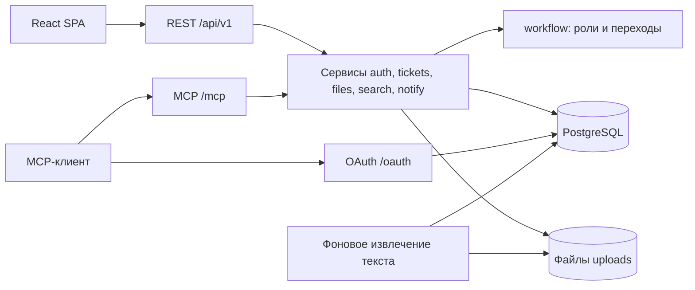

# OncePlatform: карта проекта и результаты изучения

Дата первоначального обзора: 22 октября 2026 года. Ниже сохранён снимок состояния до доработок; на момент обзора код приложения и конфигурация не изменялись.

После обзора реализованы поля шорт-листа, защита по source_url, новое правило просрочки и причины проигрыша через MCP. Добавлены интеграционные и HTTP/MCP-тесты. Актуальные контракты и результаты проверок — в [SHORTLIST.md](SHORTLIST.md).

OncePlatform — внутренний портал небольшой команды для работы с задачами и тендерами. Это модульный монолит: один Go-процесс обслуживает REST API, встроенный React-интерфейс, OAuth и MCP. PostgreSQL хранит бизнес-данные, а файловая система — оригиналы вложений. Встроенной генерации ответов LLM нет: внешний MCP-клиент работает с порталом от имени пользователя.

## Архитектура

| Область | Основные файлы | Назначение |
| --- | --- | --- |
| Запуск | `cmd/server/main.go` | Конфигурация, соединение с БД, миграции, начальные пользователи, сервисы, HTTP, фоновые задачи, завершение |
| Настройки | `internal/config/config.go` | Переменные окружения, публичный URL, часовой пояс, БД, размер файлов, начальные аккаунты |
| HTTP | `internal/httpapi/` | Chi-router, обработчики, сессия, CSRF, заголовки, ошибки, статика SPA |
| Авторизация | `internal/auth/` | Пользователи, Argon2id, сессии, персональные токены, ограничение попыток входа |
| Правила | `internal/workflow/workflow.go` | Матрица разрешений и переходы статусов |
| Задачи | `internal/tickets/` | Создание, изменение, статусы, решения и версии, комментарии, канбан и сводка |
| Вложения | `internal/files/` | Проверка типа, запись, скачивание, категории, извлечение текста |
| Поиск | `internal/search/`, `internal/db/textsearch.go` | Поиск по задачам, комментариям и тексту файлов |
| Уведомления | `internal/notify/` | Назначения, статусы, упоминания, приближение дедлайна |
| Аудит | `internal/audit/` | Запись действий, история задачи, лента и административный журнал |
| OAuth | `internal/oauth/` | Регистрация клиентов, consent, PKCE, обмен кода, refresh, отзыв доступа |
| MCP | `internal/mcp/` | 12 инструментов и prompt `analyze_tender` |
| БД | `internal/db/`, `internal/migrations/` | pgxpool, SQL-транзакции, Goose; одна миграция, 14 таблиц |
| Демо | `internal/seed/seed.go` | 12 примеров задач через бизнес-сервисы при `SEED_DEMO=true` |
| Интерфейс | `web/src/` | Страницы, общие компоненты, API-клиент, состояние сессии, локализация |
| Встраивание | `internal/webui/embed.go`, `web/vite.config.ts` | Vite пишет в `internal/webui/dist`, Go встраивает результат |
| Эксплуатация | `Dockerfile`, `docker-compose.yml`, `deploy/`, `scripts/` | Контейнеры, прокси, Synology/Tailscale, бэкап и восстановление |

В `go.mod` указан Go 1.27.0. Основные серверные зависимости: Chi, pgx/v5, Goose, официальный MCP Go SDK, Excelize, x/crypto. SQL написан вручную, ORM отсутствует.

Frontend: React 19.3.1, TypeScript 5.9.3, Vite 7.3.7, Tailwind 4.3.3, TanStack Query, React Router, dnd-kit, react-markdown. Версии здесь взяты из файлов проекта, без проверки актуальности в реестрах.

## Предметная модель и правила

Основная сущность — задача с номером `T-YYYY-NNNN`, заголовком, описанием, ссылкой, дедлайном, приоритетом, исполнителем и техническим решением. Отсутствие исполнителя означает «для всей команды». Все три роли могут читать все задачи: назначение исполнителя не ограничивает видимость.

| Возможность | Admin | Coordinator | Analyst |
| --- | --- | --- | --- |
| Просмотр задач, поиск, файлы | Да | Да | Да |
| Создание и основные поля | Да | Да | Нет |
| Техническое решение | Да | Нет | Да |
| Добавление файлов и комментариев | Да | Да | Да |
| Удаление задачи или вложения | Да | Нет | Нет |
| Пользователи, общий аудит, OAuth-клиенты | Да | Нет | Нет |

Свои комментарии можно редактировать и удалять; администратор также может удалять чужие. Удаление задач, комментариев и вложений мягкое, оригиналы файлов остаются на диске.

Поток: `new → analysis → solution → sent → closed`. Первый переход доступен координатору и администратору; следующие два — аналитику и администратору; закрытие — администратору. Возврат на один шаг из `analysis`, `solution`, `sent` доступен всем ролям с комментарием. Администратор может пропускать этапы и переоткрывать задачи. Любой переход назад требует объяснения; закрытие требует `won`, `lost`, `cancelled` или `no_bid`.

Правила проверяются бизнес-сервисами, поэтому REST и MCP используют одну логику. UI получает разрешения пользователя и доступные переходы карточки. Изменения задач, их аудит и связанные уведомления обычно входят в одну SQL-транзакцию. Изменения основных полей, статусов и решения используют блокировку строки задачи. Версии решения сохраняются отдельно, идентичное сохранение обычно не создаёт новую версию.

SQL содержит дополнительные поля `type`, `platform`, `tender_number`, `budget_amount`, `currency`, `tags`, которых нет в текущих Go/TS-моделях карточки и формах. Это расхождение схемы и доступного функционала, а не действующая классификация задач в интерфейсе. Отдельных модулей CRM и базы знаний сейчас нет, хотя упоминания `client`, `contact`, `kb_article` остались в административном фильтре и некоторых комментариях.

## Вход, HTTP и активный файл h_auth.go

`internal/httpapi/h_auth.go` — транспортный слой. Он регистрирует и обрабатывает вход/выход, текущего пользователя, язык, смену пароля, управление пользователями, персональные токены и OAuth-подключения. Также отдаёт `/meta`: настройки и справочники для UI. Хеширование паролей и SQL находятся в `internal/auth/`, работа с OAuth-подключениями — в `internal/oauth/`.

Сценарий входа:

1. Frontend получает CSRF-cookie через `/api/v1/auth/csrf`.
2. POST `/api/v1/auth/login` проверяет CSRF, логин, пароль, активность и лимит попыток.
3. Сервис создаёт сессию; в БД хранится SHA-256 токена, браузер получает HttpOnly-cookie.
4. CSRF-токен перевыпускается с привязкой к ID сессии.
5. `loadSession` восстанавливает пользователя; `requireUser` закрывает приватные маршруты.
6. `/auth/me` возвращает пользователя и разрешения, далее сервис проверяет конкретное действие.

Пароли хешируются Argon2id. Сессия действует 7 дней с продлением при активности, не чаще одного раза за 10 минут. После пяти неудач за минуту блокируется комбинация IP и логина на пять минут. Ограничитель находится в памяти процесса.

REST использует session-cookie; персональные и OAuth bearer-токены принимаются MCP. Наличие API-токена само по себе не даёт bearer-доступ к `/api/v1`.

Основные маршруты: `/api/v1/tickets`, `/tickets/board`, `/tickets/export.csv`, карточка и её `status`, `history`, `solution`, `comments`, `attachments`; `/dashboard`, `/search`, `/notifications`; административные `/admin/audit`, `/admin/oauth-clients`. `/healthz` проверяет работу HTTP, `/readyz` дополнительно делает ping БД.

## MCP и OAuth

MCP работает через Streamable HTTP, stateless-режим, JSON-ответы; максимальный размер запроса 16 MiB. Пользователь и его текущая роль проверяются по токену. Изменения помечаются `via=mcp`.

Инструменты: `get_overview`, `list_tickets`, `get_ticket`, `create_ticket`, `update_ticket`, `change_ticket_status`, `save_technical_solution`, `add_comment`, `list_attachments`, `read_attachment`, `upload_attachment`, `search`. Удаление через MCP не опубликовано.

OAuth реализует discovery, dynamic client registration, страницу согласия, authorization code с PKCE S256, access/refresh-токены и отзыв. Access действует час, refresh — 30 дней, код — 10 минут. Refresh ротируется, повторное использование после минутного окна приводит к отзыву семейства. Токены и секреты клиентов хранятся хешированными.

`analyze_tender` собирает инструкции и сведения о задаче, предлагает прочитать вложения и подготовить анализ. Сам сервер не вызывает модель. Сохранение анализа в этой инструкции предлагается после согласия пользователя.

## Файлы, поиск, фоновые процессы

Оригиналы сохраняются под UUID-путями `год/месяц/uuid`, вне web-root. Upload проверяет расширение и сигнатуру/структуру формата; по умолчанию лимит файла 50 MiB. MCP дополнительно принимает HTML-документы, ограничивает загрузку 10 MiB. Inline-просмотр разрешён для PDF, PNG и JPEG; остальное скачивается.

Два фоновых worker извлекают текст. Pending-записи повторно подбираются при запуске и каждые пять минут. PDF обрабатывается `pdftotext`; DOCX/PPTX — чтением XML из ZIP; XLSX — Excelize; TXT/MD/CSV — декодированием текста. Изображения, архивы и старые DOC/XLS/PPT не индексируются по содержимому. OCR отсутствует. Для MCP текст читается частями с `next_offset`.

Поиск использует PostgreSQL `tsvector` с конфигурацией `simple`, префиксами и ILIKE-подстроками; часть подстрочных запросов поддержана `pg_trgm`. Индексы обновляются триггером или generated columns. Подсветка передаётся маркерами и отображается React-элементами без вставки HTML.

Уведомления находятся внутри приложения: назначение, смена статуса, @упоминания, дедлайн менее трёх дней/суток. Проверка дедлайнов запускается через 30 секунд после старта и затем ежечасно; дубликаты подавляет ключ в БД. Отдельных email/push-интеграций нет. Очистка сессий и OAuth выполняется ежечасно.

## Frontend

`App.tsx` получает `/meta` и `/auth/me`, устанавливает часовой пояс и язык, защищает маршруты. `lib/api.ts` добавляет CSRF и один раз повторяет запрос при `csrf_failed`; загрузка файлов использует XHR для прогресса.

Страницы: сводка с дедлайнами, список с фильтрами/CSV, drag-and-drop канбан, создание и карточка задачи, поиск, уведомления, профиль, подключение Claude и администрирование. Карточка разделена на описание, решение, файлы, комментарии и историю. Kanban оптимистично перемещает карточку и откатывает при отказе сервера.

TanStack Query хранит серверное состояние в памяти. Данные бизнеса не сохраняются в localStorage; там только тема. Черновики находятся в состоянии компонентов. EN/RU-словари типизированы; язык хранится в профиле. Серверные тексты ошибок и уведомлений преимущественно английские. Даты отображаются в часовом поясе портала, по умолчанию `Asia/Almaty`.

UI обновляет сводку и канбан раз в минуту, комментарии и счётчик уведомлений — раз в 30 секунд, список файлов с pending extraction — раз в 3 секунды. Карточка задачи сама по таймеру не обновляется, но участвует в стандартном refetch при фокусе окна.

## Развёртывание

Dockerfile собирает frontend, затем Go-бинарник с embedded assets и миграциями. Runtime — Alpine с `poppler-utils`; приложение запускается от UID/GID 10001. Корневой Compose включает PostgreSQL 16, приложение, Caddy и backup-контейнер. Данные находятся в volumes.

Synology имеет отдельный Compose, `.env`, скрипты start/stop и Tailscale-контейнер вместо Caddy. `start.sh` выбирает Compose v2 либо старый `docker-compose`, использует проект `onceplatform`. Бэкапы Synology записываются в bind-каталог `deploy/synology/backups`. В `serve.json` выставлен `AllowFunnel=true`; фактические правила внешнего доступа в Tailscale в рамках изучения не проверялись.

Backup создаёт архив с `pg_dump`, uploads и manifest; расписание по умолчанию 02:30, хранение 14 дней. Restore заменяет схему БД и файлы. CLI сервера также поддерживает `healthcheck`, `version`, `reset-password`.

В локальной папке нет `.git`, README и CI-конфигурации. История изменений и состояние удалённого репозитория недоступны. В корне присутствуют два ZIP-пакета и готовый `bin/portal.exe`; содержимое исполняемого файла не использовалось как источник сведений о текущем коде.

## Найденные дефекты и риски

Ниже выводы по коду. Они не воспроизводились в запущенном приложении с PostgreSQL; где важны конкурентность, сбой или настройки среды, это указано отдельно.

1. **Высокий приоритет: секреты в поставке.** `.env.example:29` содержит значение формата ключа Tailscale, а не нейтральный placeholder; `INITIAL_PASSWORD` также задан конкретно. Полный `OncePlatform-synology.zip` включает `onceplatform/deploy/synology/.env`. Действительность ключа не проверялась. Если он рабочий, его следует отозвать/заменить; шаблон и распространяемые архивы должны обходиться без реальных секретов. Значения в этот документ не скопированы.

2. **Восстановление решения очищает поле редактора.** `internal/tickets/solution.go:68` создаёт `SolutionVersion` без `Body`; `RestoreSolutionVersion` возвращает этот объект через HTTP. `web/src/pages/ticket/SolutionTab.tsx:68` выполняет `setDraft(v.body ?? '')`. В БД старая версия восстановится, но пользователь увидит пустой черновик, который может затем сохранить поверх решения. Нужно согласовать контракт ответа либо заполнять редактор из заново загруженной карточки.

3. **Редактор не подхватывает внешнее обновление решения.** В `SolutionTab.tsx:23` `dirty` сравнивает черновик уже с новым `saved`. Если до refetch черновик совпадал с прежним серверным текстом, после внешнего изменения `dirty` становится true; эффект на строке 27 не обновляет редактор. Старая версия ошибочно выглядит локальной правкой. Нужен отдельный baseline последнего принятого серверного текста; при настоящем конфликте следует дать пользователю выбор.

4. **Черновики теряются при внутренней навигации.** `SolutionTab.tsx:30` защищает только `beforeunload`. Переключение вкладки карточки размонтирует редактор (`TicketPage.tsx`), переход по SPA-ссылке не выгружает документ. Несохранённый текст исчезает без предупреждения. Нужна защита навигации/смены вкладки или сохранение черновика выше размонтируемого компонента.

5. **Restore не учитывает Synology.** `scripts/restore.sh:12` переходит в корень и далее жёстко вызывает `docker compose` без выбора файла и env. У Synology конфигурация находится в другом каталоге; её start поддерживает и Compose v1. Скрипт может не найти настройки или работать с неверной конфигурацией. Дополнительно `DROP SCHEMA` выполняется до транзакционного `pg_restore`: если восстановление не удастся, прежняя схема уже удалена. Это сценарий отказа по коду, восстановление не запускалось.

6. **Планировщик не гарантирует обещанный повтор backup.** `scripts/backup.sh:65` разрешает запуск только при точном совпадении текущей минуты с `BACKUP_TIME`. Если ошибка заняла эту минуту, сообщение «will retry in a minute» не соответствует поведению: следующая попытка будет лишь на следующий день. Старт контейнера после времени расписания также пропускает день. Нужны отдельное время следующей попытки и учёт последнего успешного backup.

7. **OAuth refresh не атомарен с выпуском новых токенов.** `internal/oauth/token.go:218` отзывает старый refresh отдельным запросом, затем `issueTokens` на строке 225 открывает другую транзакцию. Сбой между ними лишит клиента действующего refresh. Аналогично использование authorization code фиксируется до выпуска токенов. Следует определить поведение при сбоях/повторных запросах и протестировать транзакционные границы.

8. **Защита последнего администратора подвержена гонке.** В `internal/auth/service.go:299` подсчёт других активных администраторов не защищён общей блокировкой. Два администратора могут одновременно деактивировать друг друга: оба увидят другого активным и обе операции пройдут. Также текущее состояние пользователя читается до транзакции обновления. Нужна сериализация изменения состава администраторов; конкурентный сценарий требует интеграционного теста.

9. **Частичный bootstrap не восстанавливается автоматически.** `EnsureInitialUsers` прекращает работу при наличии хотя бы одного пользователя и создаёт аккаунты отдельными транзакциями. Ошибка на втором аккаунте оставит первый; на следующем запуске остальные не создадутся. При неблагоприятном порядке пользователей можно остаться без администратора. Нужна атомарная инициализация либо идемпотентное создание отсутствующих аккаунтов.

10. **Разные правила пароля в UI и API.** Backend и подсказка допускают 8 символов, а `web/src/pages/ProfilePage.tsx:62` и `:69` требуют 10. Администратор создаёт пароли от 8 символов. Следует использовать единое правило, включая согласованный подсчёт Unicode-символов.

11. **CSV защищает не все текстовые поля.** `internal/httpapi/h_tickets.go:159` применяет `csvSafe` к заголовку и ссылке, но не к имени исполнителя и автора на следующей строке. Имена допускают начальные символы формул. Следует применять экранирование ко всем управляемым пользователем текстовым ячейкам. Выполнение формул в Excel не проверялось.

12. **Ограничение результата extraction не равно ограничению ресурсов.** `extractPPTX` собирает текст всех слайдов до финального обрезания; лимит XML установлен на каждый отдельный part. XLSX допускает распаковку до 1 GiB и использует `GetRows`. Эти обработчики выполняются в процессе HTTP-сервера; в отличие от PDF у них нет собственного таймаута. Для крупных/неблагоприятных файлов нужен общий бюджет памяти/распаковки и управляемое прекращение обработки. OOM не воспроизводился.

Дополнительные ограничения, существенные при развитии:

- MCP `list_tickets` эмулирует offset загрузкой всех предыдущих строк; сервис ограничивает выборку 10 000. При большем total и offset=10 000 возвращаются пустые items и тот же `next_offset` — пагинация перестаёт продвигаться.
- Канбан ограничен 2 000 карточками суммарно; значения total считаются по этой усечённой выборке. CSV ограничен 10 000 задачами. История аудита задачи возвращает первые 1 000 событий по возрастанию — новые события сверх лимита перестанут отображаться.
- Поиск в UI показывает максимум 50 результатов категории без следующей страницы. Backend при offset за концом выдачи теряет total, поскольку получает его через `count(*) OVER()` только из возвращённых строк.
- Ключ карточки TanStack Query строится по URL-ref, но дочерние вкладки инвалидируют по номеру. При открытии карточки по UUID часть обновлений попадёт в другой cache key.
- При HTTP 401 сбрасывается только `['me']`, а остальные query-кэши сохраняются. Нужна явная очистка/изоляция данных при смене аккаунта, особенно уведомлений и токенов; обычный logout уже очищает кэш.
- Доверенными прокси считаются все приватные сети. При прямом LAN-доступе на опубликованный порт 8080 клиент из такой сети может влиять на доверяемые forwarded-заголовки. Следует согласовать границу доверия с реальной схемой прокси.
- Backend сообщает большинство ошибок по-английски и хранит текст уведомлений по-английски независимо от выбранного RU-интерфейса.

## Выполненные проверки

| Проверка | Результат |
| --- | --- |
| `go test ./...` | Успешно; пакеты с тестами использовали Go test cache |
| `go vet ./...` | Успешно |
| `npm run typecheck` | Успешно |
| `go build -o <временный exe> ./cmd/server` | Успешно |
| Vite production build в отдельную временную папку | Успешно, 2 096 обработанных модулей |
| SHA-256 свежих `index.html`, основного JS и CSS против `internal/webui/dist` | Все три совпадают |
| Доступность Docker Engine | Недоступен pipe `dockerDesktopLinuxEngine` |

Первый запуск Vite в песочнице завершился `spawn EPERM` при старте esbuild; повтор с разрешённым запуском дочернего процесса прошёл. Исходный `dist` не перезаписывался. Сборка Go проверялась с уже существующим embedded frontend; совпадение основных frontend-артефактов проверено отдельно.

В проекте 8 Go-файлов тестов, 32 функции `Test...`. Покрываются матрица ролей/переходов, пароли и токены, CSRF-примитив, limiter, PKCE/redirect/resource, валидация и извлечение некоторых форматов, даты, поисковые утилиты, mentions, каталог MCP tools/prompts и отказ неаутентифицированному вызову. Интеграционных тестов с PostgreSQL, HTTP-сценариев и frontend/E2E-тестов не обнаружено. Проценты покрытия не измерялись.

Не проверены на запущенной системе: миграция в реальную БД, полный login/CRUD/restore flow, OAuth-подключение внешнего клиента, PDF extraction через установленный poppler, визуальное поведение браузера, NAS/Tailscale и восстановление backup. Актуальность и уязвимости сторонних зависимостей в реестрах не проверялись.

## Приоритет дальнейшей работы

Сначала проверить и убрать реальные секреты из шаблонов/пакетов, затем исправить контракт восстановления решения и работу черновиков. Далее согласовать восстановление с Synology, исправить повтор backup и добавить интеграционные тесты для БД, авторизации, ролей и версий решения. После этого — атомарность OAuth/bootstrap, конкурентные изменения пользователей, ограничения extraction и пагинации.

Архитектура позволяет делать эти изменения локально в соответствующих модулях. Основная ценность текущего устройства — общие бизнес-сервисы для UI и MCP; основная нехватка проверок — взаимодействие этих сервисов с реальной БД и состоянием frontend.
